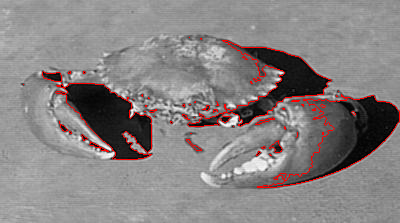
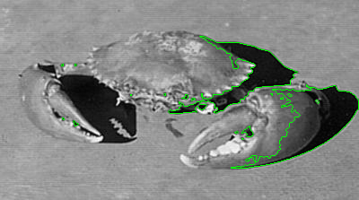
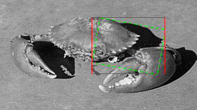
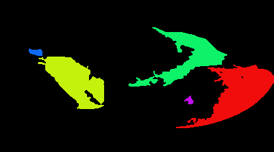

# image-debug-utils

Some niche but useful utilities for [`imageproc`](https://github.com/image-rs/imageproc).

## Usage

## Examples

### Visual Comparison

Demonstration of `remove_hypotenuse_owned` filtering out high-aspect-ratio artifacts (thin lines) from a synthetic shape.

| Before Processing | After `remove_hypotenuse_owned` |
| :---: | :---: |
|  |  |
| *Original contours (Red) showing noisy thin lines* | *Processed contours (Green) with noise removed* |

### Feature Gallery

| Intelligent Bounding Boxes | Connected Components Labeling |
| :---: | :---: |
|  |  |
| *Converting Rotated Rects (Green) to AABB (Red)* | *Visualizing Top-5 connected regions with distinct colors* |

### Interactive Demo

Explore an interactive [WASM visualizer](examples/visualizer) to experiment with these utilities in real-time.
